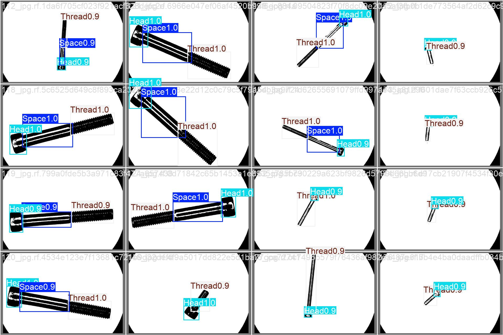
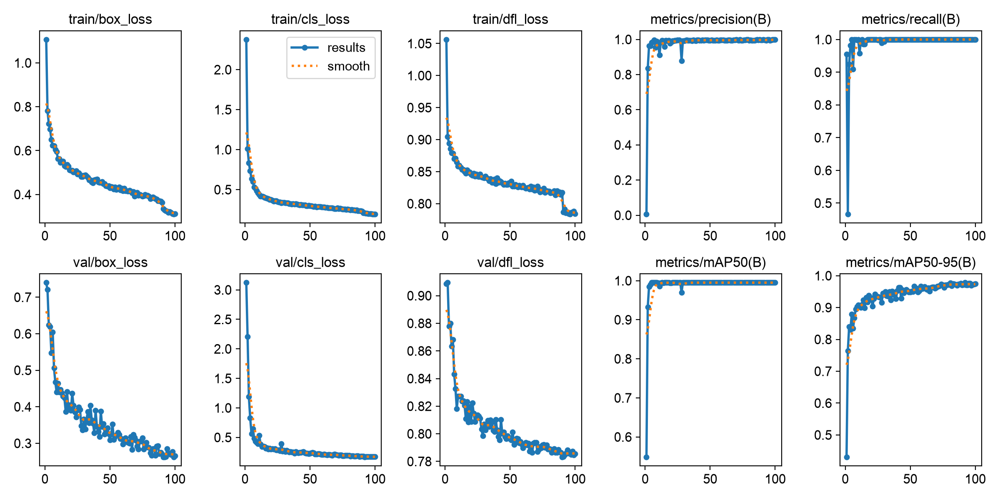
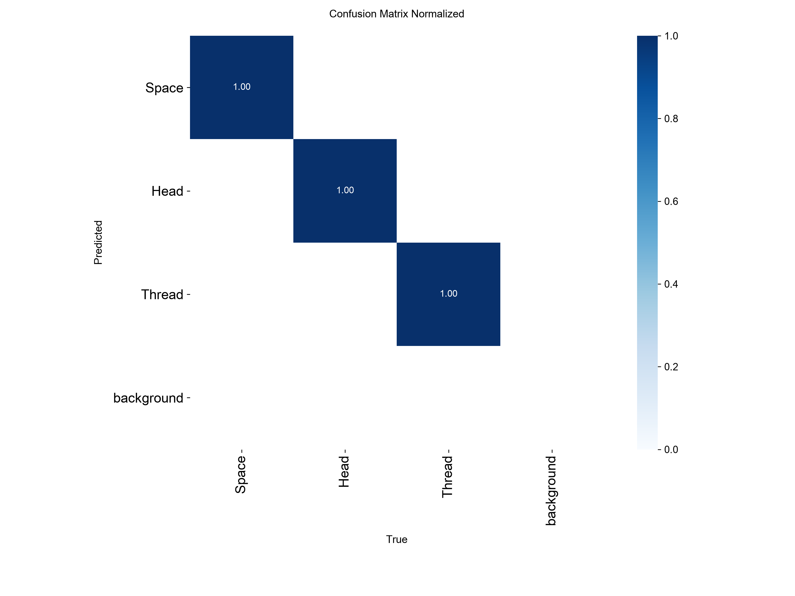

# ScrewSense — 螺絲即時偵測、計數與分類（YOLOv8）

用 YOLOv8n 訓練模型，辨識螺絲的三個部位：**Head**（頭）、**Thread**（螺紋）、**Space**（無螺紋段）。再把同一顆螺絲的部位框合併起來，從相機畫面即時做到：

- **偵測**：標出每個部位的位置
- **計數**：追蹤每顆螺絲，連續出現 1 秒以上才計入，避免誤判
- **分類**：依螺絲在畫面中的長度自動分成 Type_A、Type_B…，不用事先設定有幾種



## 模型表現

在驗證集（37 張）上的結果，訓練 100 epochs：

| Precision | Recall | mAP@50 | mAP@50-95 |
|:---:|:---:|:---:|:---:|
| 0.999 | 1.000 | 0.995 | 0.974 |

| 訓練曲線 | 混淆矩陣 |
|:---:|:---:|
|  |  |

## 做法

1. **部位偵測**：YOLOv8n 偵測 Head / Thread / Space 三類。
2. **部位合併成螺絲**：反覆合併距離最近的兩群框（框與框的最短距離 < 90px），同一群中每個類別最多一個，這樣靠得很近的兩顆螺絲也不會被併在一起。
3. **追蹤與計數**：用 YOLO 內建的追蹤器給每個框 ID，同一顆螺絲取各部位中最小的 ID 當代表。
4. **長度分類**：螺絲長度取各部位中心點的最大距離。和現有種類的中心差超過 30px 就建立新種類，否則歸入最接近的種類，並以移動平均微調該種類的中心。

## 專案結構

```
├── detect.py            # 即時偵測
├── count.py             # 即時計數
├── classify.py          # 即時長度分類
├── screw_utils.py       # 共用：部位合併、繪圖、相機、參數
├── train.py             # 訓練
├── download_dataset.py  # 從 Roboflow 下載資料集
├── models/
│   └── screw_best.pt    # 訓練好的模型
└── docs/images/         # README 用的圖
```

## 使用方式

```bash
pip install -r requirements.txt

# 即時偵測 / 計數 / 分類（預設使用相機 1 與 GPU）
python detect.py
python count.py
python classify.py

# 可調整的參數
python count.py --camera 0 --conf 0.6 --device cpu
```

按 `q` 結束。

### 自己重新訓練

```bash
# PowerShell 用 $env:ROBOFLOW_API_KEY="你的key"
export ROBOFLOW_API_KEY="你的key"
python download_dataset.py
python train.py
```

## 資料集

[Roboflow Universe — screw](https://universe.roboflow.com/mec-r9w1v/screw-lwjvf)（CC BY 4.0），共 1,195 張圖（train 1,140 / valid 37 / test 18），已做翻轉與旋轉增強。

## 使用技術

Python · Ultralytics YOLOv8 · OpenCV · Roboflow
